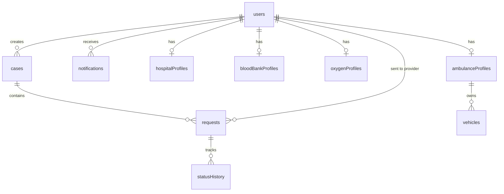
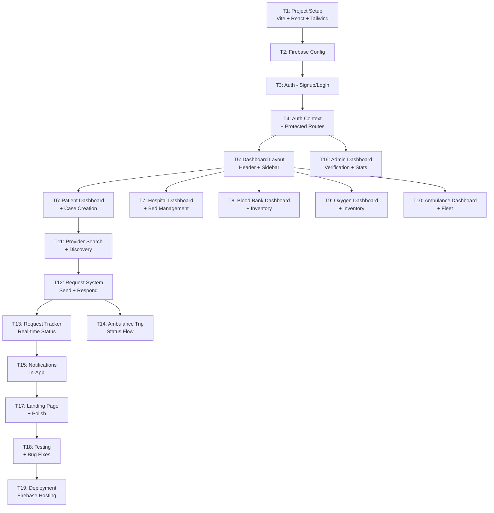

# CareBridge — Master Architecture & Implementation Plan

---

## 0. Understanding & Assumptions

### My Understanding

CareBridge is an **emergency healthcare resource coordination platform** — not a telemedicine app, not a hospital management system. Its core job is: **when a patient or attendant faces a medical emergency, help them find and request resources (beds, blood, oxygen, ambulances) from verified providers, track every request, and coordinate the response — all from one place.**

The UI takes **WhatsApp Web** as inspiration for its layout patterns (left sidebar list + right detail panel, search bar, status dots, real-time feel) but creates a completely original CareBridge brand identity.

### Key Assumptions

| # | Assumption | Rationale |
|---|-----------|-----------|
| A1 | This is a **college minor project** — we target demonstrable functionality over production scale. | Student context; free-tier Firebase. |
| A2 | All users sign up with **email + password**. Phone/OTP auth is a future enhancement. | Simplicity; Firebase free tier. |
| A3 | **No real payment processing** in Phase 1. | Out of scope for MVP. |
| A4 | **Geolocation is optional** — users can manually enter location. Leaflet map is a stretch goal. | Reduces complexity; not all browsers allow geolocation. |
| A5 | Provider data (bed counts, blood units, oxygen cylinders) is **self-reported** by providers. | Domain rule; we display "last updated" timestamps. |
| A6 | One user = one role (no multi-role accounts in Phase 1). | Simplifies RBAC. Future: role switching. |
| A7 | **Cloud Functions** are used minimally (notifications, admin stats) to stay on free/Blaze-pay-as-you-go tier. | Cost control. |
| A8 | We do **not** replace real emergency services (108/112). Disclaimers shown prominently. | Domain rule; legal safety. |
| A9 | The app is **responsive web** (mobile-first), not a native mobile app. | Scope constraint. |
| A10 | Real-time updates use **Firestore onSnapshot listeners**, not WebSockets or SSE. | Firebase-native; simplest path. |

---

## A. Requirements & User Journeys

### Stakeholder Roles

| Role | Description |
|------|------------|
| **Patient / Attendant** | Creates emergency cases, searches providers, sends resource requests, tracks status. |
| **Hospital** | Manages bed/ICU availability, receives patient admission requests, handles referrals/transfers. |
| **Blood Bank** | Manages blood inventory by group, receives & responds to blood requests. |
| **Oxygen Provider** | Manages oxygen cylinder/concentrator inventory, receives & responds to requests. |
| **Ambulance Provider** | Manages fleet, receives trip requests, updates trip status (dispatched → en route → arrived → completed). |
| **Doctor / Staff** | Affiliated with a hospital; can view & respond to cases assigned to their facility. |
| **Admin / Coordinator** | Monitors all activity, verifies providers, resolves complaints, views system-wide reports. |

### User Journeys

#### Journey 1 — Patient Emergency Flow

```
Patient signs up → Logs in → Dashboard shows active cases
  → "New Emergency" button
  → Fills case form (patient name, age, condition summary, location, urgency level)
  → System generates unique Case ID (e.g., CB-20261027-0042)
  → Patient selects needed resources (checkboxes): Bed, Blood, Oxygen, Ambulance
  → For each resource type:
      → "Find Providers" → filtered search results (by city, availability)
      → Selects a provider → "Send Request"
      → Request created with status: PENDING
  → Dashboard shows case with all linked requests
  → Real-time status updates as providers respond
  → Patient can cancel a pending request
  → If request rejected → patient can re-search and request another provider
  → Case closed manually by patient when resolved
```

#### Journey 2 — Hospital Provider Flow

```
Hospital signs up (role: hospital) → Profile setup (name, address, departments, total beds, ICU beds)
  → Dashboard shows: incoming requests | current availability
  → Hospital updates bed/ICU counts (available / occupied / total)
  → Receives admission request → reviews patient case details
  → Accepts → patient notified, request status: ACCEPTED
  → Or Rejects (with reason) → patient notified, status: REJECTED
  → Can initiate "Refer / Transfer" to another hospital
  → Updates "last updated" timestamp on every inventory change
```

#### Journey 3 — Blood Bank Flow

```
Blood bank signs up → Sets inventory: { A+: 12, B+: 8, O-: 3, ... }
  → Receives blood requests (specifying group & units needed)
  → Accepts → decrements inventory, notifies patient
  → Rejects → patient notified
  → Can update inventory anytime
```

#### Journey 4 — Oxygen Provider Flow

```
Oxygen provider signs up → Sets inventory: { cylinders: 20, concentrators: 5 }
  → Receives oxygen requests (type & quantity)
  → Accepts / Rejects → notifications sent
  → Updates inventory
```

#### Journey 5 — Ambulance Provider Flow

```
Ambulance provider signs up → Registers vehicles (ID, type, driver name)
  → Receives trip requests (pickup location, destination, patient condition)
  → Accepts → Trip status flow: DISPATCHED → EN_ROUTE → ARRIVED → PICKED_UP → IN_TRANSIT → DELIVERED → COMPLETED
  → Each status update triggers patient notification
  → Rejects → patient notified
```

#### Journey 6 — Admin / Coordinator Flow

```
Admin logs in → System-wide dashboard
  → Sees: active cases, pending requests, provider stats, alerts
  → Provider verification queue: reviews new signups, approves/rejects
  → Complaint management: views, investigates, resolves
  → Reports: cases by region, response times, resource utilization
  → Can suspend/deactivate any user
```

#### Journey 7 — Doctor / Staff Flow

```
Doctor signs up (affiliated hospital) → Sees cases routed to their hospital
  → Can add clinical notes (visible to hospital admin)
  → Can update patient status within the hospital context
```

---

## B. MVP vs. Future Features

### Phase 1 — MVP (What we build now)

| Module | Features |
|--------|----------|
| **Auth** | Email/password signup & login, role selection at signup, protected routes |
| **Profiles** | Role-specific profile setup & edit |
| **Emergency Cases** | Create case, generate Case ID, select resources, view case detail |
| **Provider Search** | Search/filter providers by type, city, availability |
| **Resource Requests** | Send request to specific provider, provider accepts/rejects, status tracking |
| **Hospital Beds** | Self-report bed/ICU availability, receive/respond to admission requests |
| **Blood Inventory** | Self-report inventory by blood group, receive/respond to blood requests |
| **Oxygen Inventory** | Self-report cylinder/concentrator counts, receive/respond to requests |
| **Ambulance** | Register vehicles, receive trip requests, basic status updates (dispatched → completed) |
| **Request Tracker** | Patient sees all requests for a case in one panel; real-time status via onSnapshot |
| **Notifications** | In-app notification bell with unread count; Firestore-driven |
| **Admin Dashboard** | Provider verification, user list, basic stats |
| **Disclaimers** | Prominent disclaimers that CareBridge does not replace emergency services |

### Phase 2 — Post-MVP Enhancements

| Feature | Priority |
|---------|----------|
| Hospital referral & patient transfer workflow | High |
| Feedback & complaints system | High |
| Ambulance live trip tracking with map (Leaflet) | Medium |
| Admin reports with Recharts | Medium |
| FCM push notifications | Medium |
| Provider ratings & reviews | Medium |
| Doctor/staff sub-role with clinical notes | Medium |
| Phone/OTP authentication | Low |
| Multi-language support (i18n) | Low |
| Dark mode toggle | Low |
| PWA offline support | Low |

---

## C. WhatsApp-Inspired UI/UX Plan

### Design Philosophy

Take WhatsApp Web's **interaction patterns**, not its branding:

| WhatsApp Pattern | CareBridge Adaptation |
|-----------------|----------------------|
| Left sidebar with chat list | Left sidebar with case list / request list / provider list |
| Right panel with chat detail | Right panel with case detail / request detail / provider profile |
| Green header with search | CareBridge-branded header (teal/coral palette) with search |
| Status dots (online/offline) | Availability dots: 🟢 Available, 🟡 Limited, 🔴 Unavailable |
| Unread message badges | Unread notification badges, pending request counts |
| Floating action button (new chat) | Floating "New Emergency" button |
| Message timestamps | Request timestamps, "last updated" on inventories |
| Typing indicator | "Provider is reviewing…" indicator |
| Reply/forward actions | Accept/Reject/Cancel action buttons on requests |

### CareBridge Brand Identity

| Element | Value |
|---------|-------|
| **Primary Color** | `#0D9488` (Teal 600) — trust, health, calm |
| **Secondary Color** | `#F97316` (Orange 500) — urgency, emergency, warmth |
| **Accent** | `#6366F1` (Indigo 500) — for admin/analytics elements |
| **Background** | `#F8FAFC` (light) / `#0F172A` (dark mode - future) |
| **Surface** | `#FFFFFF` cards with subtle `shadow-sm` |
| **Text** | `#0F172A` primary, `#64748B` secondary |
| **Font** | Inter (Google Fonts) — clean, modern, highly legible |
| **Logo concept** | Bridge icon + medical cross, stylized "CB" monogram |
| **Border radius** | `12px` for cards, `9999px` for avatars/badges |
| **Animations** | Subtle slide-in panels, fade transitions, pulse on new notifications |

### Layout Structure (All Roles)

```
┌─────────────────────────────────────────────────────┐
│  HEADER: Logo | Role Label | Search | Notifications │ Bell | Avatar  │
├──────────────┬──────────────────────────────────────┤
│              │                                      │
│  LEFT SIDE-  │       MAIN CONTENT PANEL             │
│  BAR         │                                      │
│              │   (Case detail, request detail,      │
│  - Nav links │    provider profile, forms,          │
│  - Case list │    dashboards, etc.)                 │
│  - Filters   │                                      │
│              │                                      │
│              │                                      │
├──────────────┴──────────────────────────────────────┤
│  MOBILE: Bottom tab navigation                       │
└─────────────────────────────────────────────────────┘
```

### Responsive Breakpoints

| Breakpoint | Behavior |
|-----------|----------|
| `≥1024px` (desktop) | Sidebar + main panel side-by-side |
| `768–1023px` (tablet) | Collapsible sidebar, full-width main |
| `<768px` (mobile) | Bottom tab navigation, full-screen panels with back button |

---

## D. React Project Architecture & Folder Structure

```
carebridge_minor_project/
├── public/
│   ├── index.html
│   ├── favicon.ico
│   └── manifest.json
├── src/
│   ├── main.jsx                    # React entry point
│   ├── App.jsx                     # Root component, router setup
│   │
│   ├── config/
│   │   └── firebase.js             # Firebase app init, auth, db exports
│   │
│   ├── contexts/
│   │   ├── AuthContext.jsx          # Auth state, user role, loading
│   │   └── NotificationContext.jsx  # In-app notification state
│   │
│   ├── hooks/
│   │   ├── useAuth.js               # Auth convenience hook
│   │   ├── useFirestore.js          # Generic Firestore CRUD hook
│   │   ├── useRealtimeCollection.js # onSnapshot listener hook
│   │   └── useNotifications.js      # Notification listener hook
│   │
│   ├── services/
│   │   ├── authService.js           # signup, login, logout, role setup
│   │   ├── caseService.js           # CRUD for emergency cases
│   │   ├── requestService.js        # CRUD for resource requests
│   │   ├── hospitalService.js       # Hospital profile & bed management
│   │   ├── bloodBankService.js      # Blood bank inventory & requests
│   │   ├── oxygenService.js         # Oxygen inventory & requests
│   │   ├── ambulanceService.js      # Fleet & trip management
│   │   ├── providerService.js       # Provider search & discovery
│   │   ├── notificationService.js   # Create & manage notifications
│   │   └── adminService.js          # Verification, stats, user mgmt
│   │
│   ├── components/
│   │   ├── common/
│   │   │   ├── Header.jsx
│   │   │   ├── Sidebar.jsx
│   │   │   ├── BottomNav.jsx        # Mobile bottom navigation
│   │   │   ├── SearchBar.jsx
│   │   │   ├── StatusBadge.jsx      # Colored status pill
│   │   │   ├── AvailabilityDot.jsx  # 🟢🟡🔴 indicator
│   │   │   ├── NotificationBell.jsx
│   │   │   ├── LoadingSpinner.jsx
│   │   │   ├── EmptyState.jsx
│   │   │   ├── ConfirmDialog.jsx
│   │   │   ├── Toast.jsx
│   │   │   ├── Disclaimer.jsx       # Legal disclaimer banner
│   │   │   └── ProtectedRoute.jsx   # Auth + role guard
│   │   │
│   │   ├── auth/
│   │   │   ├── LoginForm.jsx
│   │   │   ├── SignupForm.jsx
│   │   │   └── RoleSelector.jsx
│   │   │
│   │   ├── cases/
│   │   │   ├── CaseList.jsx          # Sidebar list of cases
│   │   │   ├── CaseCard.jsx          # Summary card in list
│   │   │   ├── CaseDetail.jsx        # Full case view in main panel
│   │   │   ├── CaseForm.jsx          # Create/edit case
│   │   │   └── ResourceSelector.jsx  # Checkbox grid for resource types
│   │   │
│   │   ├── requests/
│   │   │   ├── RequestList.jsx
│   │   │   ├── RequestCard.jsx
│   │   │   ├── RequestDetail.jsx
│   │   │   ├── RequestActions.jsx    # Accept/Reject/Cancel buttons
│   │   │   └── RequestTimeline.jsx   # Status history timeline
│   │   │
│   │   ├── providers/
│   │   │   ├── ProviderSearchResults.jsx
│   │   │   ├── ProviderCard.jsx
│   │   │   ├── ProviderProfile.jsx
│   │   │   └── ProviderFilters.jsx
│   │   │
│   │   ├── hospital/
│   │   │   ├── BedAvailabilityForm.jsx
│   │   │   ├── BedStatusGrid.jsx
│   │   │   └── AdmissionRequestCard.jsx
│   │   │
│   │   ├── blood/
│   │   │   ├── BloodInventoryForm.jsx
│   │   │   ├── BloodInventoryGrid.jsx
│   │   │   └── BloodRequestCard.jsx
│   │   │
│   │   ├── oxygen/
│   │   │   ├── OxygenInventoryForm.jsx
│   │   │   └── OxygenRequestCard.jsx
│   │   │
│   │   ├── ambulance/
│   │   │   ├── VehicleList.jsx
│   │   │   ├── VehicleForm.jsx
│   │   │   ├── TripRequestCard.jsx
│   │   │   └── TripStatusStepper.jsx
│   │   │
│   │   ├── notifications/
│   │   │   ├── NotificationPanel.jsx
│   │   │   └── NotificationItem.jsx
│   │   │
│   │   └── admin/
│   │       ├── VerificationQueue.jsx
│   │       ├── UserTable.jsx
│   │       ├── SystemStats.jsx
│   │       └── AdminCaseMonitor.jsx
│   │
│   ├── pages/
│   │   ├── LandingPage.jsx
│   │   ├── LoginPage.jsx
│   │   ├── SignupPage.jsx
│   │   ├── PatientDashboard.jsx
│   │   ├── HospitalDashboard.jsx
│   │   ├── BloodBankDashboard.jsx
│   │   ├── OxygenDashboard.jsx
│   │   ├── AmbulanceDashboard.jsx
│   │   ├── DoctorDashboard.jsx
│   │   ├── AdminDashboard.jsx
│   │   ├── ProfilePage.jsx
│   │   ├── ProviderSearchPage.jsx
│   │   ├── CaseDetailPage.jsx
│   │   ├── NotificationsPage.jsx
│   │   └── NotFoundPage.jsx
│   │
│   ├── layouts/
│   │   ├── AuthLayout.jsx           # Centered card for login/signup
│   │   └── DashboardLayout.jsx      # Header + Sidebar + Main panel
│   │
│   ├── utils/
│   │   ├── constants.js             # Roles, statuses, blood groups, etc.
│   │   ├── helpers.js               # Date formatting, ID generation
│   │   └── validators.js            # Form validation functions
│   │
│   └── styles/
│       └── index.css                # Tailwind directives + custom utilities
│
├── .env                             # Firebase config (gitignored)
├── .env.example                     # Template for Firebase config
├── .gitignore
├── index.html                       # Vite entry HTML
├── package.json
├── postcss.config.js
├── tailwind.config.js
├── vite.config.js
└── README.md
```

### Why This Structure?

| Decision | Beginner-Friendly Explanation |
|----------|------------------------------|
| **`services/` separate from `components/`** | Services talk to Firebase. Components show UI. Keeping them apart means you can change *how* data is stored without touching *how* it looks. |
| **`contexts/`** | React Contexts let you share data (like "who's logged in?") across many components without passing props down 10 levels. |
| **`hooks/`** | Custom hooks are reusable pieces of logic. `useRealtimeCollection` wraps Firestore's `onSnapshot` so every component can listen for changes with one line. |
| **`pages/` vs `components/`** | Pages are full screens (tied to URLs). Components are reusable building blocks used inside pages. |
| **`layouts/`** | Layouts define the common shell (header, sidebar) so individual pages don't repeat that code. |

---

## E. Firestore Data Model

### Collection Map



### Collection: `users`

Every registered user, regardless of role.

| Field | Type | Example | Notes |
|-------|------|---------|-------|
| `uid` | string | `"abc123"` | Same as Firebase Auth UID (document ID) |
| `email` | string | `"patient@example.com"` | |
| `displayName` | string | `"Rahul Sharma"` | |
| `role` | string | `"patient"` | One of: `patient`, `hospital`, `bloodBank`, `oxygenProvider`, `ambulanceProvider`, `doctor`, `admin` |
| `phone` | string | `"+919876543210"` | Optional |
| `city` | string | `"Mumbai"` | For provider search filtering |
| `state` | string | `"Maharashtra"` | |
| `address` | string | `"123 MG Road, Andheri"` | |
| `isVerified` | boolean | `true` | Admin-verified (providers) |
| `isActive` | boolean | `true` | Account active/suspended |
| `profileComplete` | boolean | `true` | Has completed role-specific profile |
| `createdAt` | timestamp | | |
| `updatedAt` | timestamp | | |

### Collection: `hospitalProfiles`

Document ID = user UID of the hospital.

| Field | Type | Example |
|-------|------|---------|
| `uid` | string | `"hosp001"` |
| `hospitalName` | string | `"City General Hospital"` |
| `registrationNumber` | string | `"MH-2024-1234"` |
| `departments` | array\<string\> | `["Emergency", "ICU", "Cardiology"]` |
| `totalBeds` | number | `200` |
| `availableBeds` | number | `34` |
| `totalICU` | number | `20` |
| `availableICU` | number | `5` |
| `totalVentilators` | number | `10` |
| `availableVentilators` | number | `3` |
| `contactNumber` | string | `"+912212345678"` |
| `operatingHours` | string | `"24/7"` |
| `city` | string | `"Mumbai"` |
| `state` | string | `"Maharashtra"` |
| `address` | string | `"Plot 5, Sector 12"` |
| `lastUpdated` | timestamp | | Self-reported availability timestamp |

### Collection: `bloodBankProfiles`

Document ID = user UID.

| Field | Type | Example |
|-------|------|---------|
| `uid` | string | `"bb001"` |
| `bankName` | string | `"Red Cross Blood Bank"` |
| `licenseNumber` | string | `"BB-MH-0056"` |
| `inventory` | map | `{ "A+": 12, "A-": 3, "B+": 8, "B-": 2, "AB+": 5, "AB-": 1, "O+": 15, "O-": 4 }` |
| `contactNumber` | string | |
| `city` | string | `"Mumbai"` |
| `state` | string | `"Maharashtra"` |
| `address` | string | |
| `lastUpdated` | timestamp | |

### Collection: `oxygenProfiles`

Document ID = user UID.

| Field | Type | Example |
|-------|------|---------|
| `uid` | string | `"oxy001"` |
| `providerName` | string | `"OxyLife Suppliers"` |
| `licenseNumber` | string | `"OX-MH-0012"` |
| `cylindersAvailable` | number | `25` |
| `concentratorsAvailable` | number | `8` |
| `deliveryAvailable` | boolean | `true` |
| `contactNumber` | string | |
| `city` | string | `"Mumbai"` |
| `state` | string | |
| `address` | string | |
| `lastUpdated` | timestamp | |

### Collection: `ambulanceProfiles`

Document ID = user UID.

| Field | Type | Example |
|-------|------|---------|
| `uid` | string | `"amb001"` |
| `providerName` | string | `"Swift Ambulance Services"` |
| `licenseNumber` | string | `"AMB-MH-0078"` |
| `contactNumber` | string | |
| `city` | string | `"Mumbai"` |
| `state` | string | |
| `address` | string | |
| `lastUpdated` | timestamp | |

### Sub-collection: `ambulanceProfiles/{uid}/vehicles`

| Field | Type | Example |
|-------|------|---------|
| `vehicleId` | string | `"MH-01-AB-1234"` |
| `vehicleType` | string | `"BLS"` | Basic Life Support / Advanced Life Support / Patient Transport |
| `driverName` | string | `"Suresh Kumar"` |
| `driverPhone` | string | `"+919876543210"` |
| `isAvailable` | boolean | `true` |
| `currentStatus` | string | `"idle"` | `idle`, `on_trip` |

### Collection: `cases`

One document per emergency case created by a patient.

| Field | Type | Example |
|-------|------|---------|
| `caseId` | string | `"CB-20261027-0042"` | Human-readable, auto-generated |
| `patientUid` | string | `"patient001"` | Creator's UID |
| `patientName` | string | `"Rahul Sharma"` | |
| `patientAge` | number | `45` | |
| `patientGender` | string | `"male"` | |
| `conditionSummary` | string | `"Severe chest pain, difficulty breathing"` | |
| `urgencyLevel` | string | `"critical"` | `critical`, `high`, `medium`, `low` |
| `resourcesNeeded` | array\<string\> | `["bed", "ambulance", "oxygen"]` | |
| `location` | map | `{ city: "Mumbai", address: "123 MG Road", state: "Maharashtra" }` | |
| `status` | string | `"active"` | `active`, `resolved`, `cancelled` |
| `requestCount` | number | `3` | Denormalized count of linked requests |
| `createdAt` | timestamp | | |
| `updatedAt` | timestamp | | |

### Collection: `requests`

One document per resource request sent from a case to a provider.

| Field | Type | Example |
|-------|------|---------|
| `requestId` | string | `"REQ-20261027-0001"` | Auto-generated |
| `caseId` | string | `"CB-20261027-0042"` | Links to parent case |
| `patientUid` | string | `"patient001"` | Who sent the request |
| `providerUid` | string | `"hosp001"` | Who receives the request |
| `providerName` | string | `"City General Hospital"` | Denormalized for display |
| `resourceType` | string | `"bed"` | `bed`, `blood`, `oxygen`, `ambulance` |
| `details` | map | `{ bedType: "ICU", bloodGroup: "O+", units: 2 }` | Type-specific details |
| `status` | string | `"pending"` | See status transitions below |
| `rejectionReason` | string | `""` | Filled if rejected |
| `respondedAt` | timestamp | | When provider responded |
| `createdAt` | timestamp | | |
| `updatedAt` | timestamp | | |

### Collection: `ambulanceTrips`

Separate from `requests` because trips have their own lifecycle.

| Field | Type | Example |
|-------|------|---------|
| `tripId` | string | `"TRIP-20261027-0001"` | |
| `requestId` | string | `"REQ-20261027-0003"` | Links to parent request |
| `caseId` | string | `"CB-20261027-0042"` | |
| `patientUid` | string | `"patient001"` | |
| `providerUid` | string | `"amb001"` | |
| `vehicleId` | string | `"MH-01-AB-1234"` | |
| `driverName` | string | `"Suresh Kumar"` | |
| `driverPhone` | string | `"+919876543210"` | |
| `pickupLocation` | map | `{ address: "123 MG Road", city: "Mumbai" }` | |
| `destinationLocation` | map | `{ address: "City Hospital", city: "Mumbai" }` | |
| `status` | string | `"dispatched"` | See trip statuses below |
| `statusHistory` | array\<map\> | `[{ status: "dispatched", timestamp: ..., note: "" }]` | |
| `createdAt` | timestamp | | |
| `updatedAt` | timestamp | | |

### Collection: `notifications`

| Field | Type | Example |
|-------|------|---------|
| `recipientUid` | string | `"patient001"` | |
| `type` | string | `"request_accepted"` | See notification types below |
| `title` | string | `"Request Accepted"` | |
| `message` | string | `"City General Hospital accepted your bed request"` | |
| `relatedCaseId` | string | `"CB-20261027-0042"` | Optional link |
| `relatedRequestId` | string | `"REQ-20261027-0001"` | Optional link |
| `isRead` | boolean | `false` | |
| `createdAt` | timestamp | | |

### Firestore Indexes Required

| Collection | Fields | Order | Purpose |
|-----------|--------|-------|---------|
| `cases` | `patientUid`, `createdAt` | ASC, DESC | Patient's case list |
| `requests` | `caseId`, `createdAt` | ASC, DESC | Requests for a case |
| `requests` | `providerUid`, `status`, `createdAt` | ASC, ASC, DESC | Provider's incoming requests |
| `notifications` | `recipientUid`, `isRead`, `createdAt` | ASC, ASC, DESC | Unread notifications |
| `hospitalProfiles` | `city`, `isVerified`, `availableBeds` | ASC, ASC, DESC | Hospital search |
| `bloodBankProfiles` | `city`, `isVerified` | ASC, ASC | Blood bank search |

### Example Documents

```json
// users/patient001
{
  "uid": "patient001",
  "email": "rahul@example.com",
  "displayName": "Rahul Sharma",
  "role": "patient",
  "phone": "+919876543210",
  "city": "Mumbai",
  "state": "Maharashtra",
  "address": "123 MG Road, Andheri West",
  "isVerified": true,
  "isActive": true,
  "profileComplete": true,
  "createdAt": "2026-10-20T10:00:00Z",
  "updatedAt": "2026-10-20T10:00:00Z"
}

// cases/CB-20261027-0042
{
  "caseId": "CB-20261027-0042",
  "patientUid": "patient001",
  "patientName": "Rahul Sharma",
  "patientAge": 45,
  "patientGender": "male",
  "conditionSummary": "Severe chest pain, difficulty breathing",
  "urgencyLevel": "critical",
  "resourcesNeeded": ["bed", "ambulance", "oxygen"],
  "location": { "city": "Mumbai", "address": "123 MG Road", "state": "Maharashtra" },
  "status": "active",
  "requestCount": 3,
  "createdAt": "2026-10-27T10:15:00Z",
  "updatedAt": "2026-10-27T10:45:00Z"
}

// requests/REQ-20261027-0001
{
  "requestId": "REQ-20261027-0001",
  "caseId": "CB-20261027-0042",
  "patientUid": "patient001",
  "providerUid": "hosp001",
  "providerName": "City General Hospital",
  "resourceType": "bed",
  "details": { "bedType": "ICU" },
  "status": "accepted",
  "rejectionReason": "",
  "respondedAt": "2026-10-27T10:30:00Z",
  "createdAt": "2026-10-27T10:20:00Z",
  "updatedAt": "2026-10-27T10:30:00Z"
}
```

---

## F. Authentication, Roles, Security & Privacy

### Authentication Flow

```
User opens app → Landing page with "Login" / "Sign Up"
  → Sign Up: email, password, display name, role selection
  → Firebase Auth creates account → Firestore `users` doc created with role
  → Redirect to role-specific dashboard
  → Login: email + password → Firebase Auth → read role from Firestore → redirect
  → Logout: Firebase signOut → redirect to landing
```

### Role-Permission Matrix

| Action | Patient | Hospital | Blood Bank | Oxygen | Ambulance | Doctor | Admin |
|--------|---------|----------|------------|--------|-----------|--------|-------|
| Create case | ✅ | — | — | — | — | — | — |
| View own cases | ✅ | — | — | — | — | — | ✅ |
| Search providers | ✅ | — | — | — | — | — | ✅ |
| Send request | ✅ | — | — | — | — | — | — |
| Respond to request | — | ✅ | ✅ | ✅ | ✅ | — | — |
| Update inventory | — | ✅ | ✅ | ✅ | ✅ | — | — |
| View assigned cases | — | ✅ | — | — | — | ✅ | ✅ |
| Verify providers | — | — | — | — | — | — | ✅ |
| View all users | — | — | — | — | — | — | ✅ |
| Suspend users | — | — | — | — | — | — | ✅ |
| View system reports | — | — | — | — | — | — | ✅ |

### Firestore Security Rules (Conceptual)

```javascript
rules_version = '2';
service cloud.firestore {
  match /databases/{database}/documents {

    // Users: can read own, admin can read all
    match /users/{userId} {
      allow read: if request.auth.uid == userId || isAdmin();
      allow create: if request.auth.uid == userId;
      allow update: if request.auth.uid == userId || isAdmin();
    }

    // Cases: creator can CRUD, admin can read
    match /cases/{caseId} {
      allow read: if request.auth != null &&
        (resource.data.patientUid == request.auth.uid || isAdmin() || isLinkedProvider());
      allow create: if request.auth != null && isPatient();
      allow update: if resource.data.patientUid == request.auth.uid;
    }

    // Requests: patient (creator) and provider (recipient) can read/update
    match /requests/{requestId} {
      allow read: if request.auth != null &&
        (resource.data.patientUid == request.auth.uid ||
         resource.data.providerUid == request.auth.uid || isAdmin());
      allow create: if request.auth != null && isPatient();
      allow update: if resource.data.providerUid == request.auth.uid ||
                       resource.data.patientUid == request.auth.uid;
    }

    // Provider profiles: owner can write, authenticated users can read (for search)
    match /hospitalProfiles/{uid} {
      allow read: if request.auth != null;
      allow write: if request.auth.uid == uid;
    }
    // (Similar for bloodBankProfiles, oxygenProfiles, ambulanceProfiles)

    // Notifications: recipient can read/update
    match /notifications/{notifId} {
      allow read, update: if resource.data.recipientUid == request.auth.uid;
      allow create: if request.auth != null;
    }

    // Helper functions
    function isAdmin() {
      return get(/databases/$(database)/documents/users/$(request.auth.uid)).data.role == 'admin';
    }
    function isPatient() {
      return get(/databases/$(database)/documents/users/$(request.auth.uid)).data.role == 'patient';
    }
  }
}
```

### Privacy & Patient Data Protection

| Rule | Implementation |
|------|---------------|
| Patient data visible only to: patient, their request's provider, admin | Firestore rules + app-level filtering |
| No patient medical details in provider search results | Search returns provider info only, not patient data |
| Condition summary visible only after request accepted | App-level: show full details only when request.status != 'pending' (or show partial) |
| No data export or sharing feature in Phase 1 | Not implemented |
| Display disclaimer on every case creation | `<Disclaimer />` component |

---

## G. Workflows & Status Transitions

### Emergency Case Status

```
                ┌──────────┐
                │  ACTIVE  │ ← Created by patient
                └────┬─────┘
                     │
          ┌──────────┼──────────┐
          ▼                     ▼
    ┌───────────┐        ┌────────────┐
    │ RESOLVED  │        │ CANCELLED  │
    └───────────┘        └────────────┘
    (Patient marks         (Patient cancels
     case as resolved)      — all pending
                            requests also
                            cancelled)
```

> **Rule**: A rejected request does NOT auto-close the case. The patient can send new requests to other providers.

### Resource Request Status

```
    ┌─────────┐
    │ PENDING │ ← Patient sends request
    └────┬────┘
         │
    ┌────┴────────────────┐
    ▼                     ▼
┌──────────┐       ┌──────────┐
│ ACCEPTED │       │ REJECTED │ (provider gives reason)
└────┬─────┘       └──────────┘
     │
     ▼
┌───────────┐
│ COMPLETED │ (provider marks service delivered)
└───────────┘

Special: Patient can CANCEL a PENDING request.
         PENDING → CANCELLED
```

### Ambulance Trip Status (Separate from Request)

```
DISPATCHED → EN_ROUTE → ARRIVED → PICKED_UP → IN_TRANSIT → DELIVERED → COMPLETED
```

Each transition recorded with timestamp in `statusHistory` array.

### Blood/Oxygen Request — Extra Detail

When a blood bank **accepts** a blood request for 2 units of O+:
1. Request status → `ACCEPTED`
2. Blood bank's `inventory["O+"]` decremented by 2
3. Notification sent to patient
4. `lastUpdated` timestamp refreshed

---

## H. Real-Time Updates & Notification Architecture

### Real-Time via Firestore `onSnapshot`

| Listener | Where Used | What it Watches |
|----------|-----------|----------------|
| Patient's case list | PatientDashboard | `cases` where `patientUid == currentUser` |
| Requests for a case | CaseDetailPage | `requests` where `caseId == selectedCase` |
| Provider's incoming requests | ProviderDashboard | `requests` where `providerUid == currentUser` |
| Notifications | NotificationBell | `notifications` where `recipientUid == currentUser && isRead == false` |
| Ambulance trip status | TripStatusStepper | `ambulanceTrips` where `tripId == selectedTrip` |

### In-App Notification Types

| Type | Trigger | Recipient |
|------|---------|-----------|
| `request_received` | Patient sends request | Provider |
| `request_accepted` | Provider accepts | Patient |
| `request_rejected` | Provider rejects | Patient |
| `request_cancelled` | Patient cancels | Provider |
| `trip_status_update` | Ambulance status changes | Patient |
| `provider_verified` | Admin verifies provider | Provider |
| `case_resolved` | Patient resolves case | Linked providers |

### Notification Flow

```
Action occurs (e.g., provider accepts request)
  → Service function updates request status in Firestore
  → Same service function creates notification document in `notifications` collection
  → Recipient's NotificationBell has onSnapshot listener on their notifications
  → Bell count updates in real-time
  → Clicking bell opens NotificationPanel with list
  → Clicking a notification marks it read and navigates to related case/request
```

> **Phase 2**: Firebase Cloud Messaging (FCM) for browser push notifications when user has the tab in background.

---

## I. Routes, Pages & Components

### Route Table

| Path | Page Component | Access | Layout |
|------|---------------|--------|--------|
| `/` | `LandingPage` | Public | None (full-page) |
| `/login` | `LoginPage` | Public | `AuthLayout` |
| `/signup` | `SignupPage` | Public | `AuthLayout` |
| `/dashboard` | Role-based redirect | Auth required | `DashboardLayout` |
| `/dashboard/patient` | `PatientDashboard` | Patient only | `DashboardLayout` |
| `/dashboard/hospital` | `HospitalDashboard` | Hospital only | `DashboardLayout` |
| `/dashboard/blood-bank` | `BloodBankDashboard` | Blood Bank only | `DashboardLayout` |
| `/dashboard/oxygen` | `OxygenDashboard` | Oxygen only | `DashboardLayout` |
| `/dashboard/ambulance` | `AmbulanceDashboard` | Ambulance only | `DashboardLayout` |
| `/dashboard/doctor` | `DoctorDashboard` | Doctor only | `DashboardLayout` |
| `/dashboard/admin` | `AdminDashboard` | Admin only | `DashboardLayout` |
| `/cases/new` | `CaseForm` (create) | Patient | `DashboardLayout` |
| `/cases/:caseId` | `CaseDetailPage` | Patient (owner), linked providers, Admin | `DashboardLayout` |
| `/providers/search` | `ProviderSearchPage` | Patient | `DashboardLayout` |
| `/profile` | `ProfilePage` | Auth required | `DashboardLayout` |
| `/notifications` | `NotificationsPage` | Auth required | `DashboardLayout` |
| `*` | `NotFoundPage` | Public | None |

### Dashboard Content by Role

| Role | Dashboard Shows |
|------|----------------|
| **Patient** | Active cases list (sidebar) · Case detail (main panel) · "New Emergency" FAB · Quick stats (active cases, pending requests) |
| **Hospital** | Incoming requests list · Bed/ICU availability panel · Quick update form · Response actions |
| **Blood Bank** | Incoming blood requests · Inventory grid (8 blood groups) · Quick update form |
| **Oxygen Provider** | Incoming requests · Cylinder/concentrator counts · Quick update form |
| **Ambulance** | Incoming trip requests · Active trips with status stepper · Vehicle fleet list |
| **Doctor** | Cases assigned to their hospital · Read-only case details |
| **Admin** | System stats cards · Verification queue · Recent cases feed · User table |

### Reusable Component Library

| Component | Used By |
|-----------|---------|
| `Header` | All authenticated pages |
| `Sidebar` | Desktop dashboard layout |
| `BottomNav` | Mobile dashboard layout |
| `SearchBar` | Provider search, admin user search |
| `StatusBadge` | Cases, requests, trips — colored pill |
| `AvailabilityDot` | Provider cards — 🟢🟡🔴 |
| `NotificationBell` | Header — badge count + dropdown |
| `LoadingSpinner` | All async operations |
| `EmptyState` | No cases, no requests, no results |
| `ConfirmDialog` | Cancel, reject, close actions |
| `Toast` | Success/error feedback |
| `Disclaimer` | Case creation, landing page |
| `ProtectedRoute` | Route wrapper for auth + role check |

---

## J. Phased Implementation Roadmap

### Task Dependency Graph



### Detailed Task Breakdown

---

#### Task 1 — Project Scaffolding
**What**: Initialize Vite + React project, install Tailwind CSS, set up folder structure, configure paths.
**Acceptance Criteria**:
- `npm run dev` starts and shows a blank page with CareBridge title
- Tailwind utility classes work
- All folders from architecture exist (empty placeholder files OK)
**Test**: Run dev server → inspect rendered page → verify Tailwind class applies color
**Estimated effort**: ~30 min

---

#### Task 2 — Firebase Configuration
**What**: Create Firebase project, enable Auth + Firestore, add config to `.env`, create `firebase.js`.
**Acceptance Criteria**:
- `firebase.js` exports `app`, `auth`, `db`
- Console log confirms Firebase initialized
- `.env.example` documents required variables
**Test**: Import `db` in `App.jsx` → console log → no errors
**Estimated effort**: ~20 min

---

#### Task 3 — Authentication (Signup + Login)
**What**: Build `LoginPage`, `SignupPage` with `LoginForm`, `SignupForm`, `RoleSelector`. Implement `authService.js` with `signUp`, `signIn`, `signOut`. Create user document in Firestore on signup.
**Acceptance Criteria**:
- User can sign up with email, password, name, and role
- User doc created in Firestore with correct role
- User can log in and is redirected
- Errors shown for invalid email, weak password, existing email
**Test**: Sign up as patient → check Firestore console → log out → log back in
**Estimated effort**: ~1.5 hrs

---

#### Task 4 — Auth Context + Protected Routes + Role Routing
**What**: Build `AuthContext` (provides `user`, `userProfile`, `loading`). Build `ProtectedRoute` component. Implement role-based redirect from `/dashboard`.
**Acceptance Criteria**:
- Unauthenticated user redirected to `/login`
- Patient lands on `/dashboard/patient`, hospital on `/dashboard/hospital`, etc.
- Direct URL access to wrong role's dashboard shows 403 or redirects
**Test**: Log in as each role → verify correct dashboard route
**Estimated effort**: ~1 hr

---

#### Task 5 — Dashboard Layout (Header + Sidebar + Shell)
**What**: Build `DashboardLayout`, `Header`, `Sidebar`, `BottomNav`. WhatsApp-inspired layout with CareBridge branding. Responsive.
**Acceptance Criteria**:
- Desktop: sidebar + main panel side by side
- Mobile: bottom tabs, collapsible sidebar
- Header shows logo, role label, placeholder notification bell, avatar
- Navigation links for current role
**Test**: Resize browser → verify responsive behavior
**Estimated effort**: ~2 hrs

---

#### Task 6 — Patient Dashboard + Emergency Case Creation
**What**: Build `PatientDashboard`, `CaseForm`, `CaseList`, `CaseCard`, `CaseDetail`. Implement `caseService.js` with create, read, update. Generate Case IDs.
**Acceptance Criteria**:
- Patient sees their case list in sidebar
- "New Emergency" button opens case creation form
- Form validates required fields
- Case created in Firestore with generated ID
- Case appears in list immediately (onSnapshot)
- Case detail panel shows all case info
**Test**: Create case → verify in Firestore → see it in list → click → see detail
**Estimated effort**: ~2.5 hrs

---

#### Task 7 — Hospital Dashboard + Bed Management
**What**: Build `HospitalDashboard`, `BedAvailabilityForm`, `BedStatusGrid`. Implement `hospitalService.js`. Profile setup for hospitals.
**Acceptance Criteria**:
- Hospital can set up profile (name, departments, bed counts)
- Can update available beds/ICU/ventilators
- `lastUpdated` timestamp refreshes on update
- Dashboard shows current availability with visual indicators
**Test**: Sign up as hospital → fill profile → update beds → verify Firestore
**Estimated effort**: ~2 hrs

---

#### Task 8 — Blood Bank Dashboard + Inventory
**What**: Build `BloodBankDashboard`, `BloodInventoryForm`, `BloodInventoryGrid`. Implement `bloodBankService.js`.
**Acceptance Criteria**:
- Blood bank can set inventory for all 8 blood groups
- Visual grid shows units per group with color coding (low = red)
- Updates reflect immediately
**Test**: Set inventory → update → verify Firestore → check grid colors
**Estimated effort**: ~1.5 hrs

---

#### Task 9 — Oxygen Provider Dashboard + Inventory
**What**: Build `OxygenDashboard`, `OxygenInventoryForm`. Implement `oxygenService.js`.
**Acceptance Criteria**:
- Can set cylinder and concentrator counts
- Dashboard shows availability status
**Test**: Set inventory → verify Firestore → check dashboard
**Estimated effort**: ~1 hr

---

#### Task 10 — Ambulance Provider Dashboard + Fleet Management
**What**: Build `AmbulanceDashboard`, `VehicleList`, `VehicleForm`. Implement `ambulanceService.js`.
**Acceptance Criteria**:
- Can add/edit/remove vehicles
- Each vehicle shows availability status
- Vehicle list displays in dashboard
**Test**: Add vehicle → verify subcollection in Firestore → see in list
**Estimated effort**: ~1.5 hrs

---

#### Task 11 — Provider Search & Discovery
**What**: Build `ProviderSearchPage`, `ProviderSearchResults`, `ProviderCard`, `ProviderFilters`. Implement `providerService.js`.
**Acceptance Criteria**:
- Patient can search by resource type (hospital, blood bank, oxygen, ambulance)
- Filter by city
- Results show availability dots, last-updated timestamps
- "Last updated X minutes ago" warning if stale (>1 hour)
- Disclaimer: "Availability is self-reported"
**Test**: Create providers → search as patient → verify filters → check stale warnings
**Estimated effort**: ~2 hrs

---

#### Task 12 — Resource Request System
**What**: Build `RequestCard`, `RequestDetail`, `RequestActions`. Implement `requestService.js`. Connect provider search → send request → provider receives → accepts/rejects.
**Acceptance Criteria**:
- Patient selects provider from search → "Send Request" with details
- Request appears in provider's dashboard as `PENDING`
- Provider can accept (status → `ACCEPTED`) or reject with reason (`REJECTED`)
- Patient can cancel pending request (`CANCELLED`)
- Status changes update in real-time for both parties
**Test**: Full flow: patient sends → provider sees → accepts → patient sees accepted
**Estimated effort**: ~3 hrs

---

#### Task 13 — Request Tracker (Real-Time)
**What**: Build `RequestList`, `RequestTimeline` inside `CaseDetail`. Show all requests for a case with real-time status.
**Acceptance Criteria**:
- Case detail panel shows all linked requests
- Each request shows current status with colored badge
- Timeline shows status history with timestamps
- Updates appear without page refresh
**Test**: Open case detail → have provider change status → see update live
**Estimated effort**: ~1.5 hrs

---

#### Task 14 — Ambulance Trip Status Flow
**What**: Build `TripRequestCard`, `TripStatusStepper`. Implement trip lifecycle in `ambulanceService.js`.
**Acceptance Criteria**:
- When ambulance request accepted → trip document created
- Provider can advance trip through statuses (DISPATCHED → ... → COMPLETED)
- Patient sees stepper with current position
- Each status change recorded with timestamp
**Test**: Accept ambulance request → advance through statuses → verify stepper
**Estimated effort**: ~2 hrs

---

#### Task 15 — In-App Notifications
**What**: Build `NotificationBell`, `NotificationPanel`, `NotificationItem`. Implement `notificationService.js`. Wire notifications into all status-change flows.
**Acceptance Criteria**:
- Bell shows unread count (real-time)
- Clicking bell opens dropdown with notification list
- Clicking notification marks as read and navigates to related case/request
- Notifications created on: request sent/accepted/rejected/cancelled, trip updates
**Test**: Trigger status change → check bell updates → click → verify navigation
**Estimated effort**: ~2 hrs

---

#### Task 16 — Admin Dashboard
**What**: Build `AdminDashboard`, `VerificationQueue`, `UserTable`, `SystemStats`. Implement `adminService.js`.
**Acceptance Criteria**:
- Admin sees provider verification queue (unverified signups)
- Can approve/reject providers
- User table with search, filter by role, activate/deactivate
- Stats cards: total users, active cases, pending requests
**Test**: Sign up as provider → admin approves → provider's `isVerified` = true
**Estimated effort**: ~2.5 hrs

---

#### Task 17 — Landing Page + UI Polish
**What**: Build `LandingPage` with hero, features, CTA. Polish all pages: animations, transitions, error states, empty states, loading states.
**Acceptance Criteria**:
- Landing page is visually impressive with CareBridge branding
- Smooth transitions between sidebar and detail views
- All loading states show spinner
- All empty states show helpful message + CTA
- All error states show friendly message
- Disclaimer visible on landing and case creation
**Test**: Navigate entire app → verify no rough edges
**Estimated effort**: ~3 hrs

---

#### Task 18 — Testing & Bug Fixes
**What**: End-to-end walkthrough of every user journey. Fix bugs, edge cases, responsiveness issues.
**Acceptance Criteria**:
- All 7 user journeys complete without errors
- Responsive at all breakpoints
- No console errors
- Firestore rules deployed and working
**Test**: Full manual test of all journeys
**Estimated effort**: ~3 hrs

---

#### Task 19 — Deployment
**What**: Deploy to Firebase Hosting. Set up production Firestore rules. Configure environment.
**Acceptance Criteria**:
- App accessible via Firebase Hosting URL
- Auth, Firestore, and all features work in production
- Security rules deployed
**Test**: Access deployed URL → full walkthrough
**Estimated effort**: ~1 hr

---

### Total Estimated Effort: ~34 hours

---

## K. Firebase Setup & Free-Tier Considerations

### Firebase Services Used

| Service | Free Tier Limit | Our Usage |
|---------|----------------|-----------|
| **Authentication** | 10K verifications/month | Well within (demo users) |
| **Cloud Firestore** | 50K reads, 20K writes, 20K deletes per day | Adequate for dev/demo. Real-time listeners count as reads. |
| **Firebase Hosting** | 10 GB storage, 360 MB/day transfer | Static site, well within |
| **Cloud Functions** | 2M invocations/month (Blaze only) | Phase 2 only; keep minimal |
| **Firebase Storage** | 5 GB storage, 1 GB/day download | Profile images only; minimal |
| **Cloud Messaging** | Free unlimited | Phase 2 |

### Cost Optimization Rules

1. **Limit onSnapshot listeners** — only subscribe to what's visible on screen; unsubscribe on unmount.
2. **Denormalize provider names** in request documents to avoid extra reads.
3. **Paginate lists** — load 20 items at a time, not entire collections.
4. **Use composite indexes** to avoid full-collection scans.
5. **Cache user profile** in AuthContext — don't re-read on every page.

### Firebase Project Setup Steps (for Task 2)

1. Go to [console.firebase.google.com](https://console.firebase.google.com)
2. Create project "CareBridge" (disable Google Analytics for simplicity)
3. Enable Authentication → Email/Password provider
4. Create Cloud Firestore database (start in test mode, we'll add rules later)
5. Register a Web app → copy config to `.env`
6. Install `firebase` npm package

---

## L. Risks, Assumptions, Limitations & External Dependencies

### Risks

| Risk | Likelihood | Impact | Mitigation |
|------|-----------|--------|-----------|
| Firestore free-tier exhaustion during development | Low | Medium | Use emulators for heavy testing; monitor usage in console |
| Real-time listeners causing excessive reads | Medium | Medium | Unsubscribe on unmount; paginate; limit listener scope |
| Complex security rules are hard to debug | Medium | High | Use Firestore emulator + rules unit tests |
| Scope creep (student adding features mid-project) | High | High | Strict task-by-task execution; no skipping ahead |
| Firebase service outage | Very Low | High | Out of our control; Google's SLA |

### Limitations

1. **No real emergency dispatch** — CareBridge is a coordination tool, not a replacement for 108/112.
2. **Self-reported data** — Provider availability may be stale. We timestamp + warn, but can't verify.
3. **No payment processing** — Resource requests don't involve billing.
4. **Single role per user** — A hospital admin can't also be a patient on the same account.
5. **No offline support** — Requires internet connection.
6. **No end-to-end encryption** — Firestore data readable by admin; not HIPAA compliant.
7. **No automated matching** — Patient manually selects providers; no auto-dispatch in Phase 1.

### External Dependencies

| Dependency | Purpose | Risk |
|-----------|---------|------|
| Firebase (Google) | Auth, DB, Hosting | Very stable; free tier sufficient |
| Vite | Build tool | Active maintenance; stable |
| React 18+ | UI framework | Stable; LTS |
| Tailwind CSS | Styling | Stable |
| React Router v6 | Client routing | Stable |
| Google Fonts (Inter) | Typography | CDN; very reliable |

---

## M. End-to-End Completion Checklist

- [ ] **T1** — Project scaffolding (Vite + React + Tailwind + folder structure)
- [ ] **T2** — Firebase configuration (.env + firebase.js)
- [ ] **T3** — Authentication (Signup + Login + Role selection)
- [ ] **T4** — Auth Context + Protected Routes + Role-based routing
- [ ] **T5** — Dashboard Layout (Header + Sidebar + Responsive shell)
- [ ] **T6** — Patient Dashboard + Emergency Case creation
- [ ] **T7** — Hospital Dashboard + Bed/ICU management
- [ ] **T8** — Blood Bank Dashboard + Inventory management
- [ ] **T9** — Oxygen Provider Dashboard + Inventory
- [ ] **T10** — Ambulance Dashboard + Fleet management
- [ ] **T11** — Provider Search & Discovery
- [ ] **T12** — Resource Request System (send + respond)
- [ ] **T13** — Request Tracker (real-time status in case detail)
- [ ] **T14** — Ambulance Trip status flow
- [ ] **T15** — In-App Notifications
- [ ] **T16** — Admin Dashboard (verification + stats + user mgmt)
- [ ] **T17** — Landing Page + UI Polish + Disclaimers
- [ ] **T18** — Full testing & bug fixes
- [ ] **T19** — Firebase Hosting deployment
- [ ] **Post-MVP** — Referrals, Feedback, Maps, Push Notifications, Reports

---

## 🚀 Recommended First Task

**Task 1 — Project Scaffolding**

This sets up the empty project with Vite, React, Tailwind CSS, the folder structure, and a basic "Hello CareBridge" page. Everything else depends on this foundation.

**I will NOT execute this until you say "go" or "approve Task 1".**
